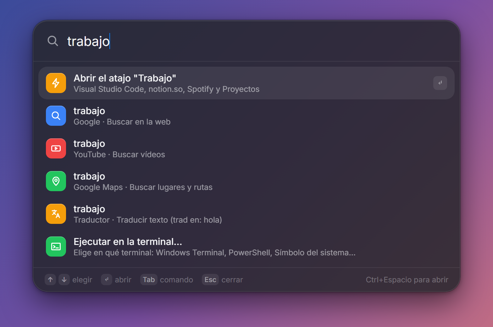
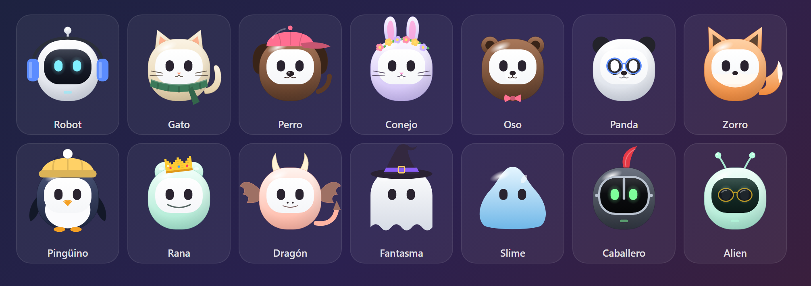
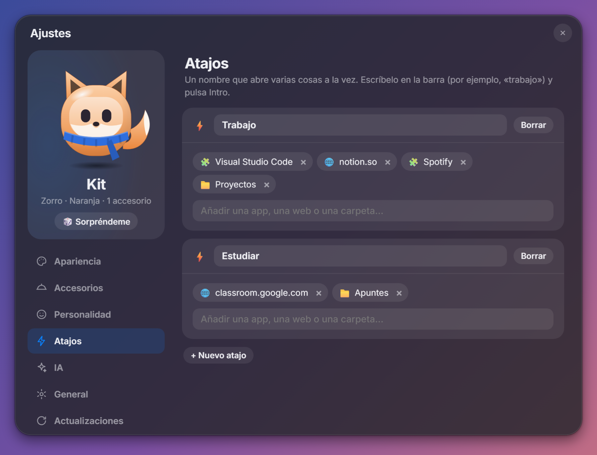
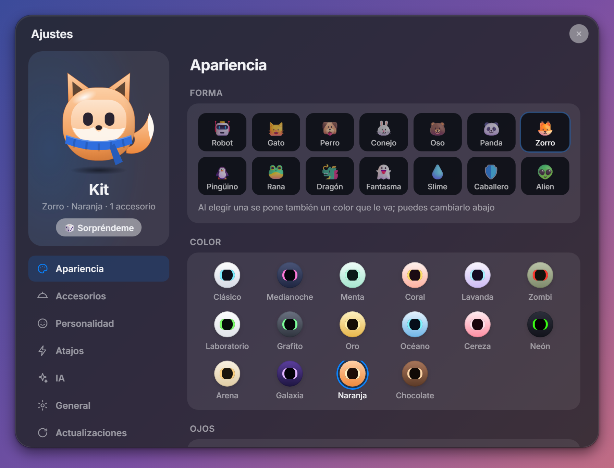

# Mascota

Asistente de escritorio para Windows que vive en una isla en el borde superior
de la pantalla. Una barra de comandos para buscar, abrir apps, controlar el PC y
la música, y una mascota personalizable (robot, gato, zorro, dragón…) que te
acompaña. Con IA local opcional que se ejecuta íntegramente en tu equipo.

[](https://github.com/jmfl2/MascotaIA/releases/latest/download/Mascota-Setup.exe)

[](https://github.com/jmfl2/MascotaIA/releases/latest)
[](LICENSE)




## Características

- **La isla:** una píldora en el borde superior de la pantalla que crece al
  acercar el ratón. Muestra la canción que suena con carátula, controles y una
  barra para saltar a cualquier punto; la barra de volumen; la batería cuando
  carga o queda poca, y los avisos (recordatorios, Pomodoro, actualizaciones).
- **Barra de comandos** (`Ctrl+Espacio`): búsqueda en Google, YouTube, Maps y
  GitHub, traductor, calculadora, lanzador de aplicaciones y favoritos. Al
  abrirla, tus aplicaciones más usadas aparecen las primeras.
- **Atajos propios:** un nombre («trabajo») que abre a la vez varias apps, webs
  y carpetas.
- **Control del PC:** bloquear, suspender, apagar o reiniciar (con 30 segundos
  para cancelar), volumen con una barra que se arrastra y modo oscuro o claro de
  Windows.
- **Terminal y programas:** ejecuta lo que escribes en la terminal que elijas
  (PowerShell, Símbolo del sistema, Git Bash…) y cierra programas abiertos.
- **Productividad:** notas rápidas, recordatorios en lenguaje natural
  (`rec mañana 9:00 dentista`) y temporizador Pomodoro.
- **IA local con Ollama** (opcional): chat, resúmenes, explicaciones y
  comandos en lenguaje natural. Ningún texto sale de tu equipo.
- **Claude, ChatGPT, Perplexity y Gemini:** pregúntales desde la barra o desde
  lo que copias; se abre su web con la pregunta escrita. Con una clave de API
  de Anthropic (opcional), Claude responde dentro de la barra.
- **Detector de enlaces sospechosos:** analiza en local los enlaces que copias
  y avisa de suplantaciones, homógrafos y acortadores.
- **Portapapeles inteligente:** al copiar un texto ofrece buscarlo, traducirlo,
  guardarlo, resumirlo o preguntárselo a una IA, e ignora contraseñas y claves.
- **Personalizable:** catorce formas de mascota, dieciséis colores, cuarenta y
  siete accesorios, cinco formas de ojos, nombre y personalidad, y el tema y el
  color de acento de la barra y las ventanas.
- **Fechas especiales:** en Navidad, Año Nuevo, Halloween y San Valentín se
  disfraza sola, con nieve, confeti, murciélagos o corazones.
- **Se actualiza sola:** descarga las versiones nuevas de GitHub y comprueba su
  huella antes de instalarlas.
- **Ligera y discreta:** en reposo apenas consume recursos, y el trabajo de
  fondo se reparte para no dar tirones al arrancar.
- **En español e inglés:** el idioma se elige en los ajustes; la primera vez se
  usa el de Windows.



## Instalación

1. Descarga el instalador:
   **[Mascota-Setup.exe](https://github.com/jmfl2/MascotaIA/releases/latest/download/Mascota-Setup.exe)**.
2. Ejecútalo. El instalador no está firmado con un certificado comercial, por lo
   que Windows SmartScreen mostrará un aviso de editor desconocido. Selecciona
   *Más información* y después *Ejecutar de todas formas*.
3. Sigue el asistente. La instalación es para el usuario actual y no requiere
   permisos de administrador.

Requisitos: Windows 10 u 11 de 64 bits.

### IA local (opcional)

Las funciones de IA necesitan [Ollama](https://ollama.com):

1. Descarga e instala Ollama:
   **[OllamaSetup.exe](https://ollama.com/download/OllamaSetup.exe)**.
2. Abre la barra de Mascota, escribe `ia` y selecciona *Descargar el modelo*
   (`gemma3:4b`, unos 3,3 GB). También está disponible en el icono de la
   bandeja, en *IA local*.

Sin Ollama, el resto de funciones está disponible con normalidad.

### Desinstalación

Desde *Configuración de Windows → Aplicaciones*. Los datos (notas,
recordatorios y ajustes) se conservan en `%APPDATA%\mascota`. Elimina esa
carpeta si no deseas mantenerlos.

## Uso

Acerca el ratón a la isla del borde superior y haz clic, o pulsa
`Ctrl+Espacio`, para abrir la barra de comandos. Si está activado *Bajar al
abrir la barra* (en Ajustes → General), la mascota baja de la isla mientras la
barra está abierta.

Sin prefijo, el texto se busca en Google y se sugieren las aplicaciones, los
atajos y las acciones que coinciden. Con un prefijo seguido de un espacio se usa
un comando concreto:

| Prefijo                     | Función            | Ejemplo                                                    |
| --------------------------- | ------------------ | ---------------------------------------------------------- |
| `g`                         | Google             | `g receta de croquetas`                                    |
| `a`, `abrir`, `app`, `open` | Apps y favoritos   | `a calculadora` · sin texto: favoritos                     |
| `atajo`, `atajos`           | Atajos propios     | `atajo` lista los tuyos · sin prefijo: escribe su nombre   |
| `pc`, `sistema`             | Control del PC     | `bloquear` · `apagar` · `modo oscuro` (sin prefijo también) |
| `volumen`, `vol`            | Barra de volumen   | `volumen` abre la barra de volumen en la isla              |
| `>`, `term`, `terminal`     | Terminal           | `> ipconfig` · elige la terminal                           |
| `cerrar`, `kill`, `proc`    | Cerrar programas   | `cerrar chrome` · `Supr` lo fuerza                         |
| `yt`                        | YouTube            | `yt lofi para estudiar`                                    |
| `maps`, `map`               | Google Maps        | `maps farmacia de guardia`                                 |
| `gh`                        | GitHub             | `gh electron/electron`                                     |
| `trad`, `tr`                | Traductor          | `trad hello world` · `trad en: buenos días`                |
| `nota`, `notas`, `n`, `note` | Notas             | `nota comprar pilas` · `notas` para listar y buscar        |
| `rec`, `recordar`, `r`, `remind` | Recordatorios | `rec 10m sacar la ropa` · `rec 18:30 llamar` · `rec tomorrow 8am run` |
| `pomo`, `pomodoro`          | Pomodoro           | `pomo` (25/5) · `pomo 50/10`                               |
| `ia`, `ai`, `chat`, `?`     | Chat con la IA     | `ia ¿qué es una API REST?`                                 |
| `resumir`, `explicar`       | Resumir o explicar | Sin texto, usa el contenido del portapapeles               |
| `link`, `enlace`, `url`     | Comprobar enlace   | `link https://bit.ly/...`                                  |
| `claude`, `cl`              | Claude             | `claude ¿por qué el cielo es azul?`                        |
| `gpt`, `chatgpt`            | ChatGPT            | `gpt ideas para una cena`                                  |
| `pplx`, `perplexity`        | Perplexity         | `pplx mejores portátiles 2026`                             |
| `gem`, `gemini`             | Gemini             | Copia la pregunta y abre Gemini para pegarla               |
| `=`, `calc`                 | Calculadora        | `= 12*7+3` · `calc 30 c en f` (sin prefijo también)        |
| `ajustes`, `config`, `skin` | Ajustes            | Abre la ventana de ajustes                                 |

Los recordatorios aceptan `10m`, `45s`, `2h`, `1h30m`, `en 20 minutos`,
`18:30`, `a las 9`, `mañana 9:00` y `mañana a las 8`, y también en inglés
(`in 20 minutes`, `6:30pm`, `tomorrow at 8am`). Si la hora ya ha pasado, se
programan para el día siguiente.

### Teclado

| Tecla                       | Acción                                                  |
| --------------------------- | ------------------------------------------------------- |
| `↑` `↓` `RePág` `AvPág`     | Seleccionar fila                                        |
| `Intro`                     | Ejecutar la fila seleccionada                           |
| `Supr`                      | Borrar nota, cancelar recordatorio, quitar favorito, forzar el cierre de un programa o quitar de las más usadas |
| `Tab`                       | Fijar el comando de la fila seleccionada                |
| `Retroceso`                 | Con el campo vacío, quitar el comando fijado            |
| `Ctrl+N`                    | En el chat, empezar una conversación nueva              |
| `Esc`                       | Cerrar la barra o detener la respuesta de la IA         |

## Funciones

### La isla

- **Música:** muestra lo que suena en Spotify, el navegador u otras apps, con
  carátula, botones de anterior, pausa y siguiente, y una barra con el tiempo.
  Si la app lo permite, al tocar la barra salta a ese punto.
- **Volumen:** escribe `volumen` y la isla se convierte en una barra que se
  arrastra o se mueve con la rueda del ratón; el altavoz silencia.
- **Batería:** a su lado aparece la batería mientras carga o cuando queda poca,
  con avisos al enchufar el cargador y al bajar del 20 % y del 10 %.
- **Avisos:** los recordatorios, el Pomodoro y las actualizaciones aparecen
  dentro de la isla, que se agranda con sus botones. Si la isla está oculta, se
  muestran como notificaciones de Windows.


### Atajos propios

En *Ajustes → Atajos* creas un nombre que abre varias cosas a la vez: apps (con
buscador), webs y carpetas o archivos, hasta ocho por atajo. Después basta con
escribir su nombre en la barra y pulsar `Intro`.



### Control del PC

Sin prefijo o con `pc`:

- `bloquear` y `suspender`, al momento.
- `apagar` y `reiniciar`, con 30 segundos para cancelarlo desde la isla.
- `volumen`, que abre la barra de volumen de la isla.
- `modo oscuro` y `modo claro` de Windows.

### Terminal y programas

- `> comando` ejecuta lo escrito en la terminal que elijas: Windows Terminal,
  PowerShell 7, Windows PowerShell, Símbolo del sistema o Git Bash. La ventana
  se queda abierta para ver el resultado y la última terminal usada aparece la
  primera. Al escribir cualquier cosa en la barra también aparece la opción
  *Ejecutar en la terminal*.
- `cerrar <programa>` lista los programas abiertos de más a menos memoria.
  `Intro` lo cierra como el botón ✕ (puede preguntar si guardas) y `Supr` lo
  fuerza. Los procesos del sistema y la propia Mascota no se muestran.

### IA local

- **Lenguaje natural:** al escribir una frase sin prefijo aparece la opción
  *Interpretar con IA*. La IA elige el comando adecuado y rellena la barra; la
  acción solo se ejecuta cuando confirmas con `Intro`. Por ejemplo,
  «recuérdame en media hora que saque la ropa» se convierte en el recordatorio
  `30m sacar la ropa`.
- **Chat:** con `ia` la barra pasa a ser una conversación con respuestas en
  tiempo real. La conversación no se guarda en disco.
- **Resumir y explicar:** disponible desde la barra o al copiar un texto largo.
- **Consumo de memoria:** el modelo solo se carga al usar la IA y se libera
  tras tres minutos sin uso, o al momento desde *bandeja → IA local → Liberar
  memoria*.
- **Privacidad:** la aplicación solo se comunica con Ollama en `127.0.0.1`.

### Detector de enlaces sospechosos

Al copiar un enlace, o al pegarlo en la barra, se analiza en local y se muestra
uno de tres veredictos: *parece una trampa* (la acción por defecto es no
abrirlo), *precaución* o *sin señales de alarma*. Se revisa lo siguiente:

- Suplantación de más de 40 marcas habituales (bancos, Correos, Agencia
  Tributaria, PayPal, Amazon, Microsoft...), con sustituciones como `paypa1` o
  `rnicrosoft`.
- Homógrafos (letras de otros alfabetos) y dominios en punycode.
- La marca fuera del dominio real (`paypal.com.verificar-cuenta.top`).
- Trucos de URL: usuario antes de `@`, direcciones IP, puertos inusuales,
  esquemas `javascript:` o `file:` y `http` sin cifrar.
- Dominios de alto riesgo, palabras de cebo y descargas con doble extensión.
- Acortadores: se consulta solo al acortador adónde redirige, sin visitar el
  destino.

Es un filtro heurístico, no un antivirus: puede no detectar un engaño bien
elaborado y puede marcar algún enlace legítimo.

### Portapapeles inteligente

Al copiar un texto, la mascota ofrece buscarlo, traducirlo, guardarlo como nota
o, con la IA disponible, resumirlo o explicarlo. No ofrece nada cuando:

- la aplicación de origen lo marca como privado (gestores de contraseñas como
  Bitwarden, 1Password o KeePass);
- el texto parece una contraseña, una clave de API, un token, una clave privada,
  un IBAN o una cifra larga;
- un texto largo contiene credenciales (por ejemplo, un archivo `.env`).

El texto copiado nunca se guarda ni se registra, salvo que elijas guardarlo
como nota.

### Personalización



Desde *Ajustes* (bandeja, clic derecho sobre la isla o `ajustes` en la barra):

- **Forma:** robot, gato, perro, conejo, oso, panda, zorro, pingüino, rana,
  dragón, fantasma, slime, caballero o alien. Todas se animan igual y llevan
  cualquier accesorio; los personajes son genéricos, sin copiar ninguno
  existente.
- **Color:** dieciséis combinaciones, con color propio opcional para los ojos y
  los accesorios.
- **Accesorios:** uno por zona (cabeza, cara, boca, orejas, cuello, cuerpo,
  manos, espalda y encima), con vista ampliada de cada zona. Incluye gorros,
  gafas, auriculares y objetos temáticos de videojuegos, anime y terror.
- **Ojos:** normales, redondos, finos, corazones o estrellas.
- **Personalidad:** nombre, cuánto habla (*discreto*, *normal* o *hablador*) y
  tono de la IA (cercano, formal o divertido).
- **Barra y ventanas:** tema claro, oscuro o el del sistema y color de acento.

### Otras funciones

- **Soltar archivos en la isla:** arrastra un archivo, una carpeta o un acceso
  directo sobre la isla para añadirlo a favoritos (se abren con `a <nombre>`),
  preguntarle a una IA por él, comprimirlo o copiar su ruta.
- **Bandeja del sistema:** mostrar u ocultar la mascota, elegir si baja al
  abrir la barra, cambiar el atajo, activar o desactivar funciones e iniciar
  con Windows.
- **Atajo personalizado:** además de los predefinidos de la bandeja, admite
  cualquier [acelerador de Electron](https://www.electronjs.org/docs/latest/api/accelerator)
  en el campo `shortcut` de `%APPDATA%\mascota\config.json`.

## Privacidad y datos

Todos los datos se guardan en local, en `%APPDATA%\mascota`: configuración,
notas, recordatorios, favoritos, atajos y la caché de iconos. La aplicación no
envía telemetría. Las únicas conexiones a internet son las que abres tú
(búsquedas y enlaces), la consulta al acortador al revisar un enlace acortado y
la comprobación de versiones nuevas en GitHub.

Para poder diagnosticar fallos, Mascota guarda un registro de lo que hace la
propia aplicación en `%APPDATA%\mascota\logs\mascota.log`. No incluye nada de
lo que escribes ni de lo que copias.

Los detalles de seguridad (aislamiento de las páginas, validación de URL e IPC,
límites de la IA) están en [docs/arquitectura.md](docs/arquitectura.md#seguridad).

## Desarrollo

Requisitos: Windows, [Node.js](https://nodejs.org) 20 o superior y Git.

```powershell
git clone https://github.com/jmfl2/MascotaIA.git
cd MascotaIA
npm install
npm run dev
```

| Script              | Descripción                                                  |
| ------------------- | ------------------------------------------------------------ |
| `npm run dev`       | Inicia la aplicación con recarga en caliente.                |
| `npm test`          | Ejecuta los tests (Vitest).                                  |
| `npm run typecheck` | Comprueba los tipos.                                         |
| `npm run build`     | Tipos, tests y compilación en `out/`.                        |
| `npm run preview`   | Ejecuta la versión compilada.                                |
| `npm run dist`      | Compila y genera el instalador en `dist/`.                   |
| `npm run icons`     | Regenera los iconos de `assets/`.                            |

Notas:

- Si PowerShell bloquea `npm` por la política de ejecución, usa `npm.cmd` o
  ejecuta una vez `Set-ExecutionPolicy -Scope CurrentUser RemoteSigned`.
- Desde WSL, ejecuta los comandos en PowerShell o cmd: Electron debe ser el de
  Windows para que funcionen la transparencia y la bandeja del sistema.
- La versión instalada y `npm run dev` no pueden ejecutarse a la vez.
- Con la variable `MASCOTA_LAG=1`, el registro apunta cuándo se bloquea el
  proceso principal (útil para buscar tirones).

La estructura del código, cómo añadir comandos, los tests de integración y las
decisiones de diseño están documentados en
[docs/arquitectura.md](docs/arquitectura.md).

### Publicar una versión

1. Actualiza `version` en `package.json` y haz commit.
2. Ejecuta `npm run dist`, que genera `dist\Mascota-Setup.exe`.
3. En GitHub, crea una release con la etiqueta `v<versión>` y adjunta
   `Mascota-Setup.exe`. El botón de descarga de este README apunta siempre a la
   última release, así que no hay que cambiar el enlace.

Las copias instaladas (desde la 0.3.0) encuentran la release nueva solas: la
descargan, comprueban que su huella SHA-256 coincide con la que publica GitHub
y la instalan en silencio. Para eso la release no puede ser un borrador ni una
versión previa, la etiqueta debe ser `vX.Y.Z` y el instalador debe llamarse
`Mascota-Setup.exe`.

Tecnologías: Electron, TypeScript, Vite y Motion.

## Licencia

Distribuido bajo la [licencia MIT](LICENSE).
